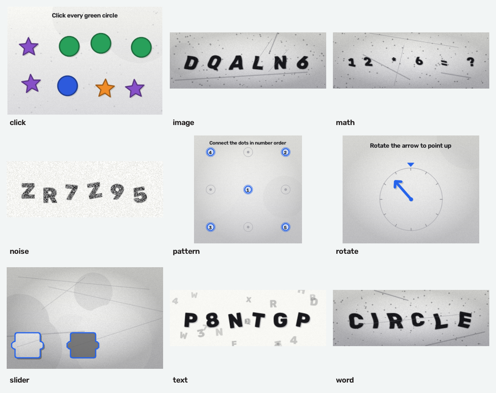

# Captcha Forge

[](https://pypi.org/project/captcha-forge/)
[](https://pypi.org/project/captcha-forge/)
[](https://github.com/shalonjovan/Captcha/actions/workflows/ci.yml)
[](https://shalonjovan.github.io/Captcha/)
[](LICENSE)

**Captcha Forge** is a modern, typed Python package for generating animated and
static CAPTCHA challenges. It ships nine challenge types, a fast OpenCV
rendering pipeline, a command-line interface, and an extension API for custom
generators.

> **Security note:** this library generates challenges; it does not validate
> answers or protect an application by itself. Store answers on the server,
> expire them, rate-limit verification attempts, and provide an accessible
> alternative. Read [docs/security.md](docs/security.md) before using it in a
> production flow.



## Highlights

- **Nine challenge types** — animated text, animated noise, distorted image,
  dictionary word, arithmetic, slider puzzle, click-to-select, connect-the-dots,
  and rotation alignment.
- **Fast by design** — pre-rendered glyph masks, vectorised NumPy compositing,
  and no per-pixel Python loops.
- **Typed, documented API** — a small `Captcha` facade, `CaptchaResult`, and
  typed configuration with clear validation errors.
- **Deterministic** — pass `seed=...` for reproducible frames, answers, and
  metadata.
- **Ready to publish** — `pyproject.toml`, src layout, tests, CI, MkDocs
  documentation, and PyPI trusted-publishing workflow.
- **Extensible** — register your own generator with one decorator.

## Performance

Rendering uses cached glyph masks and vectorised NumPy compositing. A rough
single-run benchmark is included:

```bash
python scripts/benchmark.py --repeat 2 --duration 1 --fps 15
```

On a typical development machine, static challenges complete in roughly 4–16 ms
and 15-frame animated samples in roughly 35–40 ms. Measure on your own hardware;
the script reports timings for every type.

## Installation

```bash
pip install captcha-forge
```

For a development checkout:

```bash
git clone https://github.com/shalonjovan/Captcha.git
cd Captcha
python -m venv .venv
source .venv/bin/activate
pip install -e ".[dev,docs]"
```

The package depends on `numpy`, `opencv-python-headless`, and `Pillow`.

## Quick start

```python
from captcha_forge import Captcha

challenge = Captcha(
    "text",
    width=500,
    height=160,
    duration=3.0,
    fps=30,
    seed=42,
).generate()

print(challenge.answer)          # e.g. "K7M2QP"
challenge.save("challenge.gif")  # GIF, PNG, JPEG, WebP, or MP4
```

Every generator returns a `CaptchaResult`:

```python
challenge.frames      # tuple of BGR uint8 frames (OpenCV convention)
challenge.image       # first frame
challenge.answer      # expected user response
challenge.text        # rendered text, when applicable
challenge.metadata    # type-specific details and solution geometry
challenge.assets      # extra images, such as the slider piece
challenge.save(...)   # write to disk
challenge.to_bytes()  # PNG/GIF/WebP bytes for a web response
```

`CaptchaResult` is sequence-like, so `for frame in challenge` and
`challenge[0]` still work.

## Challenge types

| Type | Kind | Default | Answer |
| --- | --- | --- | --- |
| `text` | animated GIF | 500×160 | The displayed text |
| `noise` | animated GIF | 500×160 | The displayed text |
| `image` | static PNG | 500×180 | The displayed text |
| `word` | static PNG | 500×180 | The displayed word |
| `math` | static PNG | 500×180 | Integer answer as a string |
| `slider` | static PNG | 460×300 | Target x position |
| `click` | static PNG | 460×320 | List of `[x, y]` target centres |
| `pattern` | static PNG | 380×380 | Ordered `[x, y]` coordinates |
| `rotate` | static PNG | 380×300 | Clockwise rotation in degrees |

### Examples

```python
from captcha_forge import Captcha

# Animated noise challenge
Captcha("noise", duration=4, seed=1).generate().save("noise.gif")

# Static distorted word with a custom word list
Captcha("word", wordlist=["tiger", "zebra", "otter"]).generate().save("word.png")

# Arithmetic: the answer is returned for server-side validation
math = Captcha("math", operands=3, max_operand=9, seed=2).generate()
print(math.text, "->", math.answer)

# Slider: use result.assets["piece"] and result.metadata["target_x"]
slider = Captcha("slider", seed=3).generate()
print(slider.metadata["gap_box"], slider.answer)

# Click challenge: answer is a list of coordinates
click = Captcha("click", target_count=3, decoy_count=5, seed=4).generate()
print(click.metadata["instruction"], click.answer)

# Dark theme with a custom font
Captcha("image", color_mode="dark", font_face="complex").generate().save("dark.png")
```

## Examples

Runnable scripts live in [`examples/`](examples):

- `quickstart.py` — text, image, and math challenges.
- `all_types.py` — one sample of every type.
- `custom_generator.py` — register a generator with `@register`.
- `custom_wordlist.py` — use your own words for the `word` type.
- `fastapi_server.py` — a minimal server-side token and verification flow
  (requires `pip install fastapi uvicorn`).

```bash
python examples/quickstart.py
python examples/all_types.py
```

## Command line

```bash
captcha-forge list
captcha-forge info text
captcha-forge generate text -o challenge.gif --duration 3 --seed 42
captcha-forge generate click -o click.png --option target_count=2 --json
captcha-forge generate math -o math.png --option operands=3
captcha-forge gallery -o captcha-gallery
```

`python -m captcha_forge` works as an alternative to the console script.

## Configuration

Common options are shared by every type:

```python
Captcha(
    "image",              # challenge type
    width=500,
    height=180,
    fps=30,               # animation frame rate
    duration=3.0,         # animation length in seconds
    seed=42,              # reproducible output
    color_mode="custom",  # "light", "dark", or "custom"
    background="#fff4e0", # required with color_mode="custom"
    foreground="#223344",
    font_face="duplex",   # or an OpenCV font constant
    font_scale=2.5,
    font_thickness=2,
    alphabet="ABCDEFGHJKLMNPQRSTUVWXYZ23456789",
    text="HELLO",         # force the rendered text
    length=6,             # random text length when text is None
)
```

Type-specific options are passed as keyword arguments. Names are checked when
`Captcha(...)` is constructed and values are validated by `.generate()`. Use
`Captcha.describe("text")` or `captcha-forge info text` to discover them.

## Documentation

Full documentation covers installation, every challenge type, configuration,
the CLI, recipes, extension points, and the API reference:

- [Installation](docs/installation.md)
- [Quick start](docs/quickstart.md)
- [Challenge types](docs/captcha-types.md)
- [Configuration](docs/configuration.md)
- [CLI](docs/cli.md)
- [Recipes](docs/recipes.md)
- [Extending Captcha Forge](docs/extending.md)
- [API reference](docs/api.md)
- [Security](docs/security.md)

Build the docs locally with `mkdocs serve`.

## Migration from the original module

The original repository exposed a single `Captcha` class in `captcha/captcha.py`.
Captcha Forge keeps the familiar concepts but uses a package layout and a result
object:

| Original | Captcha Forge |
| --- | --- |
| `from captcha.captcha import Captcha` | `from captcha_forge import Captcha` |
| `Captcha(captcha_type="noise", frame_size=(500, 160))` | `Captcha("noise", width=500, height=160)` |
| `captcha_text="ABC"` | `text="ABC"` |
| `color_mode="ligth"` | `color_mode="light"` (the typo is still accepted) |
| `c.generate()` returns frames | returns `CaptchaResult`; use `.frames` or iterate |
| `export=True, export_format="gif", output_name="x"` | `result.save("x.gif")` |
| `font=cv2.FONT_HERSHEY_DUPLEX` | `font_face="duplex"` or the OpenCV constant |

The legacy aliases `frame_size`, `captcha_text`, and `font` are accepted by
`CaptchaConfig` for a smoother transition.

## Development

```bash
pip install -e ".[dev,docs]"
pytest
ruff check .
ruff format --check .
mkdocs serve
python -m build
twine check dist/*
```

Generate fresh documentation samples with:

```bash
python scripts/generate_gallery.py
python scripts/benchmark.py
```

## Contributing

Contributions are welcome. Please read [CONTRIBUTING.md](CONTRIBUTING.md) and
open an issue before large changes.

## License

MIT © CacCat. See [LICENSE](LICENSE).
