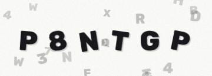
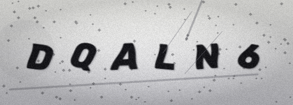
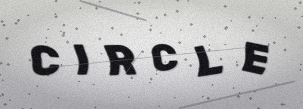
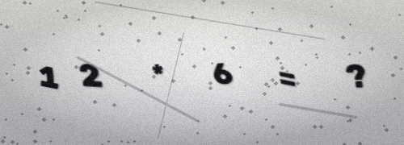
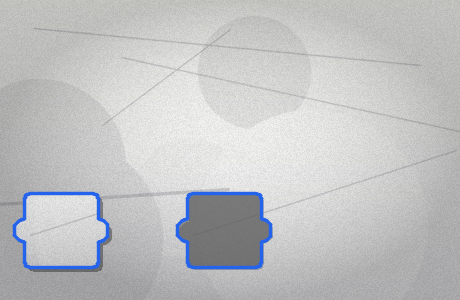
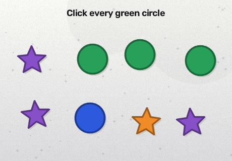
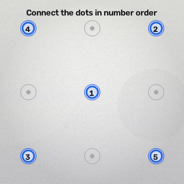
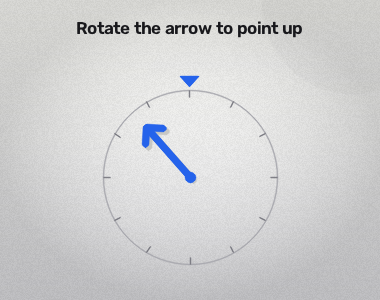

# Captcha Forge

**Generate animated and static CAPTCHA challenges in Python.**

Captcha Forge is a typed, extensible package built on OpenCV and NumPy. It
provides nine challenge types, deterministic seeds, fast vectorised rendering,
a command-line interface, and a clean result object carrying the answer and
type-specific solution metadata.

```bash
pip install captcha-forge
```

```python
from captcha_forge import Captcha

challenge = Captcha("text", seed=42, duration=3).generate()
print(challenge.answer)
challenge.save("challenge.gif")
```

## Nine challenge types

<div class="gallery" markdown>
<figure markdown>
  
  <figcaption><strong>text</strong> — drifting background glyphs</figcaption>
</figure>
<figure markdown>
  
  <figcaption><strong>noise</strong> — animated static texture</figcaption>
</figure>
<figure markdown>
  
  <figcaption><strong>image</strong> — rotation, shear, and wave</figcaption>
</figure>
<figure markdown>
  
  <figcaption><strong>word</strong> — distorted dictionary words</figcaption>
</figure>
<figure markdown>
  
  <figcaption><strong>math</strong> — arithmetic with a computed answer</figcaption>
</figure>
<figure markdown>
  
  <figcaption><strong>slider</strong> — jigsaw piece and target gap</figcaption>
</figure>
<figure markdown>
  
  <figcaption><strong>click</strong> — select matching shapes</figcaption>
</figure>
<figure markdown>
  
  <figcaption><strong>pattern</strong> — connect numbered dots</figcaption>
</figure>
<figure markdown>
  
  <figcaption><strong>rotate</strong> — align the arrow</figcaption>
</figure>
</div>

## Why Captcha Forge?

- **One small API.** `Captcha(...).generate()` returns frames, answer, metadata,
  and assets.
- **Fast rendering.** Glyph masks are cached and composited with NumPy slices;
  the original per-pixel Python loop is gone.
- **Reproducible.** `seed=...` makes frames, answers, and geometry repeatable.
- **Typed and validated.** Unknown options fail immediately with a list of
  supported options.
- **Ready to ship.** Src layout, `pyproject.toml`, tests, CI, MkDocs, and a PyPI
  publishing workflow are included.

## Where to go next

- [Installation](installation.md) — install the package and optional tooling.
- [Quick start](quickstart.md) — render, inspect, and save your first challenge.
- [Challenge types](captcha-types.md) — compare all nine types and their answers.
- [Configuration](configuration.md) — themes, colours, fonts, and options.
- [CLI](cli.md) — generate challenges from a terminal.
- [Extending](extending.md) — add your own generator.
- [Security](security.md) — use CAPTCHAs responsibly.

!!! warning "CAPTCHAs are not a complete security boundary"
    Captcha Forge generates challenges. It does not provide server-side answer
    storage, expiry, or verification. Read [Security](security.md) before using
    generated challenges in production.
